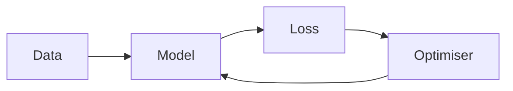

This post fits a logistic regression and reports on it, using every feature
the renderer has along the way. The numbers are made up for the example. Rest
the pointer on any reference below, "Figure 2" or "(1)" or a citation, and it
shows what it points at.

## Introduction

Quotes and dashes are typed straight and set as a printer would: "the model,"
she said, "isn't done yet" -- see pages 10--12 --- and so on... Code keeps what
was typed: `print("isn't")`.

An empty link to another post writes its title: [](/blog/writing-like-a-paper)
covers the basics, and [](/blog/math-and-citations) the maths. One to a section
here writes its number: the method is in [](#method), the results in
[](#results). A citation works as before [@knuth1984literate], and so does a
footnote, which on a wide screen stands in the margin.[^margin]

[^margin]: Numbered sections are asked for with `numbered: true` in the
    frontmatter; most posts do not need them.

## Theory

### The loss

> [!DEFINITION] Cross-entropy {#def-ce}
> For labels $y_i \in \{0, 1\}$ and predictions $p_i = \sigma(x_i^\top w)$, the
> loss of weights $w \in \R^d$ is
>
> $$
> \loss(w) = -\frac{1}{n} \sum_{i=1}^{n} \Big[ y_i \log p_i + (1 - y_i) \log (1 - p_i) \Big].
> \label{loss}
> $$

`\loss` and `\KL` are this post's own macros, defined in its frontmatter; `\R`
and `\E` come with the site. Minimising [](#eq-loss) is the same as minimising
$\E_{x}\big[\KL{p_{\text{true}}}{p_w}\big]$, up to a constant.

> [!THEOREM] Convexity {#thm-convex}
> $\loss$ is convex in $w$, so gradient descent with a small enough step
> reaches its minimum $\hat w = \argmin_w \loss(w)$.

> [!PROOF] of [](#thm-convex)
> The Hessian is $X^\top S X / n$ with $S = \operatorname{diag}\big(p_i (1 - p_i)\big)$,
> and $v^\top X^\top S X v = \lVert S^{1/2} X v \rVert^2 \ge 0$ for every $v$.

### Exercises

> [!EXERCISE] {#ex-gradient}
> Show that the gradient of [](#eq-loss) is $X^\top (p - y) / n$.

> [!SOLUTION] to [](#ex-gradient)
> Write $\ell_i = -y_i \log p_i - (1 - y_i) \log (1 - p_i)$. Since
> $\sigma'(z) = \sigma(z)\big(1 - \sigma(z)\big)$, the chain rule gives
> $\partial \ell_i / \partial w = (p_i - y_i)\, x_i$. Averaging over $i$ gives
> $X^\top (p - y) / n$.

## Method

### The algorithm

[](#alg-gd) is [](#thm-convex) put to work.

```algorithm
\begin{algorithm}
\caption{Gradient descent for logistic regression}
\label{gd}
\begin{algorithmic}
\REQUIRE data $X, y$, step size $\eta$, number of steps $T$
\STATE $w \gets 0$
\FOR{$t = 1$ \TO $T$}
  \STATE $p \gets \sigma(X w)$
  \STATE $w \gets w - \eta\, X^\top (p - y) / n$
\ENDFOR
\RETURN $w$
\end{algorithmic}
\end{algorithm}
```

### The code

[](#lst-fit) is read from the file the post links to, lines 16 to 23, so it is
the code that ran. Lines 19 to 21 are the loop.

```python file=/posts/complete-example/fit.py lines=16-23 {19-21}
```

Caption: The `fit` method of `fit.py`. {#lst-fit}

Callouts explain a listing line by line:

```python
model = LogisticRegression(step=0.5)  # <1>
model.fit(X_train, y_train)  # <2>
accuracy = (model.predict(X_test) == y_test).mean()  # <3>
```

1. A larger step than the default, which [](#fig-lr) shows is still safe.
2. Five hundred steps of [](#alg-gd).
3. The share of test points classified correctly; see [](#tbl-accuracy).

The same model in two languages:

```python tab="Python"
model = LogisticRegression().fit(X, y)
```

```r tab="R"
model <- glm(y ~ ., data = d, family = binomial)
```

And what changed when the loop learnt to stop early:

```diff-python
     for _ in range(self.steps):
         p = sigmoid(X @ self.w)
         gradient = X.T @ (p - y) / n
+        if np.linalg.norm(gradient) < 1e-6:
+            break
         self.w -= self.step * gradient
```

## Results

### Step sizes


Caption: Training loss for three step sizes. {#fig-lr}

The step in [](#fig-lr-b) is the one used for the rest of the post;
[](#fig-lr-c) diverges.

### Before and after

Two images flagged `#compare` are laid one over the other with a divider to
drag, or to move with the arrow keys once it has focus. Printed, or with no
script, they are two pictures side by side.


Caption: A photograph before and after denoising. {#fig-denoise}

### Accuracy

| Model               | Test accuracy |
| ------------------- | ------------: |
| Logistic regression |          0.86 |
| Decision tree       |          0.81 |
| Random forest       |          0.89 |

Caption: Test accuracy of three models. {#tbl-accuracy}

```vega-lite
{
  "description": "Test accuracy of three models, as bars",
  "data": {
    "values": [
      { "model": "Logistic regression", "accuracy": 0.86 },
      { "model": "Decision tree", "accuracy": 0.81 },
      { "model": "Random forest", "accuracy": 0.89 }
    ]
  },
  "mark": "bar",
  "encoding": {
    "x": { "field": "model", "type": "nominal", "title": "Model", "sort": null },
    "y": {
      "field": "accuracy",
      "type": "quantitative",
      "title": "Test accuracy",
      "scale": { "domain": [0, 1] }
    }
  }
}
```

Caption: [](#tbl-accuracy) as a chart. {#fig-accuracy}

### The pipeline



Caption: One step of training. {#fig-pipeline}

```tikz
% alt: The sigmoid curve rising from 0 to 1, crossing one half at zero
\begin{tikzpicture}[>=Stealth, xscale=0.55, yscale=2]
  \draw[->] (-5.5,0) -- (5.8,0) node[right] {$z$};
  \draw[->] (0,-0.05) -- (0,1.2) node[above] {$\sigma(z)$};
  \draw[dashed] (0,1) -- (5.5,1);
  \draw[thick, domain=-5.5:5.5, smooth, samples=80] plot (\x, {1/(1+exp(-\x))});
  \node[left] at (0,1) {$1$};
  \node[above left] at (0,0.5) {$1/2$};
\end{tikzpicture}
```

Caption: The sigmoid, $\sigma(z) = 1 / (1 + e^{-z})$. {#fig-sigmoid}

### Chemistry

The renderer has chemistry too: $\ce{2 H2 + O2 -> 2 H2O}$, with
$\Delta H = \pu{-572 kJ/mol}$.

## Media

### A recording


Caption: A sound, written as an image is, played by the browser's own player.
{#fig-chime}

### A place


Caption: A map, loaded from OpenStreetMap only when asked for. {#fig-map}

## Notes

> [!NOTE]
> Every reference in this post is a link with no text: `[](#fig-lr-b)`,
> `[](#eq-loss)`, `[](/blog/writing-like-a-paper)`. The build fills in the
> words, and warns about any that point at nothing.

<details>
<summary>What the frontmatter of this post says</summary>

```yaml
numbered: true
macros:
  # Quoted: in YAML a space before # starts a comment.
  \KL: 'D_{\mathrm{KL}}\left(#1 \,\Vert\, #2\right)'
  \loss: \mathcal{L}
```

</details>
